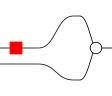

# Hexpr V2 Spec

A `hexpr` (or H-expression) is a syntax for defining arrows of symmetric monoidal categories.
In short:

- `(f g h)` is sequential composition `f ; g ; h`
- `{f g h}` is tensor product `f × g × h`
- `[x y . y z]` is a *spider*

For example, `({neg _} mul)` defines the arrow below:

# Grammar

The `hexpr` grammar is:

    hexpr := atom                        operation
           | "^" hexpr                   labeled identity wire
           | "!" hexpr                   quote
           | "(" hexpr* ")"              composition, left to right
           | "{" hexpr* "}"              tensor
           | "[" lvars ("." lvars)? "]"  Frobenius spider

    lvars := lvar*
    lvar  := var ("^" hexpr)?            spider node, optionally labeled

    atom  := op-char+                    op-char = alnum | - _ . * + / | > : = ?
    var   := (alpha | "-") (alnum | "-" | "_")*

Note:

- Reserved tokens are `( ) { } [ ] ! ^ #`
- `#` comments to the end of the line
- The "_" atom is always interpreted as the unlabeled identity wire

The following syntax interprets to the same data:

- `[xs]` ≡ `[xs . xs]`
- `^t` ≡ `[x^t]` labeled identity is the same as the labeled identity *spider*
- `_` ≡ `[x]` (unlabeled identity, the name `x` is immaterial.[^bind]

[^bind]: True for *core* (quote-free) hexprs. Macros receive syntax, and a
name-inspecting macro like `!(bind …)` distinguishes `_` from `[x]`: only
the latter is capturable.

# Interpretation

A *fully annotated* hexpr (see below) defines an *arrow* in a category `C`
which is assumed to be presented by a signature `Σ = (Σ₀, Σ₁)` consisting of:

- generating objects `Σ₀`
- generating operations `Σ₁`

The atoms (both for object labels and operations) are assumed to be elements of
`Σ₀` and `Σ₁`, respectively, but these sets are not explicitly defined by the
hexpr.
In this way, the same hexpr can be interpreted 'as needed' into a different
ambient category `C`.

By "interpretation", we more precisely mean that a hexpr is interpreted into a
[*cospan of hypergraphs*](https://docs.rs/open-hypergraphs/latest/open_hypergraphs/).

## Interpretation with Partial Object Labels

The term below is fully annotated.

    # we want to think of this as having type u64 × u64 -> u64
    ({^u64 ^u64} u64.add ^u64)

But it is also possible to use `_` to write a term with un-annotated wires:

    ({_ _} u64.add _)

In the latter case, how can we interpret it?
The arity and coarity of `u64.add` can be inferred as 2 and 1, respectively,
but the types cannot.

In this case, the arrow is interpreted into a category `U(C)` presented by
`U(Σ) = (U(Σ₀), U(Σ₁))` where

- U(Σ₀) = Σ₀ + {Unknown}
- U(Σ₁) = Σ₁

That is, the signature Σ plus an "unknown" object label--this is the type of
`_`.

Note that a *fully annotated* hexpr is guaranteed to interpret to an open
hypergraph having no `Unknown` labels.

## Expressions with ambiguous arity/coarity

It is possible to write hexprs which are not fully annotated that have
operations with ambiguous arity/coarity.
For example, consider a term

    ({_ _} f g _)

Here, the arity of `f` is `2` and coarity of `g` is `1`.
But the coarity of `f` / arity of `g` is unknown.

There are two resolutions:

1. Interpret the hexpr relative to a given signature
   (which chooses types for f and g)
2. Return an error

Both modes are possible in the library.

# Fully Annotated Terms

A term is *fully annotated* if it contains no quotes `!` and its source and
target types are computable by the structural recursion below, using no
signature and no unification. Write `src(e)` and `tgt(e)` for the computed
lists of object labels.

- `^t` is fully annotated, with `src = tgt = (t)`.
- `_` is not (its label is `Unknown` by definition).
- A bare atom by itself is not (its type is nowhere written).
- `[xs . ys]` is fully annotated iff every node carries a label on at least
  one of its occurrences in the bracket, and repeated labels agree
  syntactically. `src`/`tgt` list the node labels in occurrence order.
- `{e1 … en}` is fully annotated iff every `ei` is; boundaries concatenate.
  (`{}` is fully annotated, with empty boundary.)
- `(e1 … en)`: call an element that is a bare atom an *operation use*. Every
  other element must be fully annotated, and no operation use may be
  adjacent to another one, first, or last. An operation use takes its type
  from its neighbors: `src = tgt` of the preceding element, `tgt = src` of
  the following. All adjacent boundaries must agree syntactically:
  `tgt(ei) = src(e(i+1))`. Then `src = src(e1)`, `tgt = tgt(en)`.
  (`()` alone is not fully annotated: its boundary is undetermined.)

Every *fully annotated* term is interpretable in `C`, rather than `U(C)`:
the resulting open hypergraph has no `Unknown` labels, and each operation
use determines an element of `Σ₁` together with an explicit type. No
external signature is required — the term is its own presentation.

# Macros, Quoting, and Binding Names

TODO

# Tuples

With the changes in V2, can we define (variable arity/coarity) tuples?
Let's say we assume a builtin 'tuple' label.

    (^3 tuple) # look, we declared an arity-3 tuple!
    ({^a ^b ^c} tuple) # more verbosely, with types
